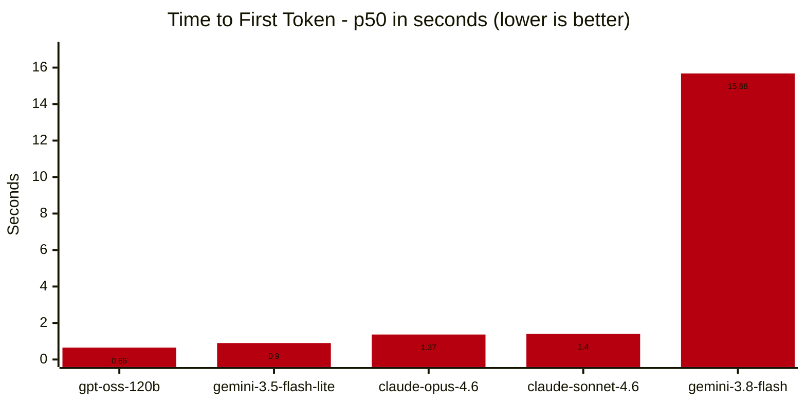
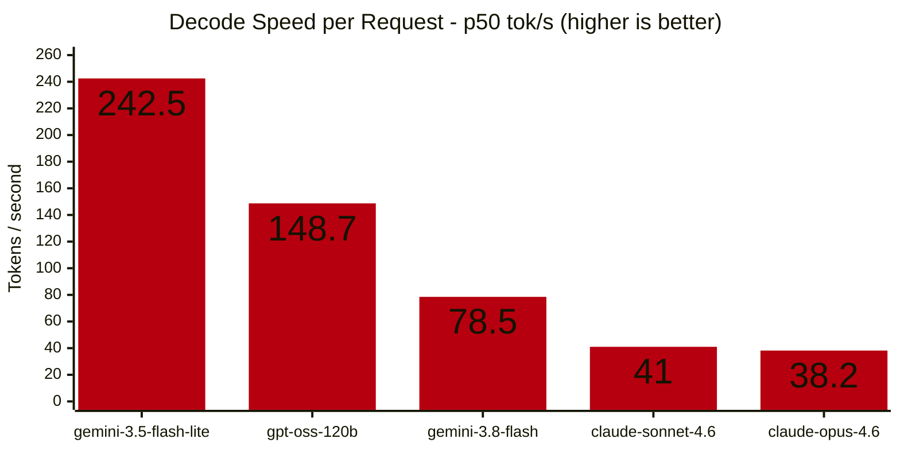

AI is a genuinely fun rabbit hole. Agentic coding and AI assistants have become my weekend experiments. The downside? My wallet takes a hit — tokens add up fast. So when I stumbled across a grey-area solution — cheap Jio invitation links for Gemini Pro going for under 50,000 IDR — I had to try it.

It's not eligible for the latest models, but the lineup is decent for the price: Claude Opus 4.6 & Sonnet 4.6, Gemini 3.8 Flash & 3.5 Flash Lite, and GPT OSS 120B. More than enough for my needs. But how does it actually hold up?

A quick note on setup: I connected this Gemini Pro subscription to [9router-go](https://github.com/luqman-v1/9router-go) via an Antigravity connector, so the models available in Antigravity could also be used in other platforms like Antigravity or Hermes Agent.

> **Update 10/29/2026:**
>
> Test re-run using OmniRoute also showing similar result for Gemini 3.8 Flash. TTFT mean is at 12 to 15 seconds. This indicate that it isn't specific 9router-go bug.

### Methodology

All tests were run on a local network. 9router-go runs on my Unraid NAS, with the client sitting in an Alpine Linux VM. Testing was automated using [llm-bench.sh](/static/assets/downloads/scripts/llm-bench.sh) — each model was tested up to 20 times and the results averaged. Everything was saved as `.csv` files.

The focus is on Gemini 3.8 Flash, for a few reasons:

1. It's the first-party model included in this subscription tier
2. It's the highest-tier model available (3.1 Pro and 4 Argon are unfortunately off the table)
3. The other models — Claude especially — are more of a bonus, since their quotas are extremely limited

### Benchmark Results

The most surprising finding: Gemini 3.8 Flash — Google's own model — is dead last when it comes to time to first token (TTFT). It averages over 15 seconds before the first token comes through the `/chat/completion` API endpoint.

My hunch is that Gemini 3.8 Flash is doing some hidden thinking under the hood. Whether that's a 9router thing or something on Antigravity's end, I'm not sure yet. I'd need to test it directly through Antigravity to know for certain.

GPT OSS 120B and Gemini 3.5 Flash Lite are the two fastest out of the gate. That's expected — both have fewer parameters, so prompt encoding just takes less time.

On decode speed (tokens per second), though, Gemini 3.8 Flash redeems itself a bit — coming in third at 78.5 tok/s. That's fine for my use case, though anyone coming from faster flash models like Deepseek v4.1 Flash will probably find it underwhelming.

As expected, GPT OSS 120B leads the pack and Opus 4.6 brings up the rear — same reasoning as above.

### Subjective Take

I've been on this subscription since mid-September 2026, using the models in Antigravity for coding and in Vellum and Hermes Agent as a personal assistant.

Sonnet 4.6 is technically showing its age compared to Sonnet 5.5 (the latest at the time of writing), but it still runs circles around flash models like Gemini 3.8 Flash or Deepseek v4.1 Flash. What I love most about Sonnet 4.6 is how well it *inhabits* a persona when set as the primary model in Vellum Assistant — the personality I configured at the start is actually followed through properly. Gemini, by contrast, just feels a bit... soulless. The catch, of course, is that the Claude quota runs out embarrassingly fast.

Sonnet 4.6 also has a way of just getting things done. Even though it's slower at generating tokens, its steps almost always land. Gemini, on the other hand, ends up looping — redoing things because of a syntax error here, a wrong assumption there.

Meanwhile, Gemini 3.8 Flash — which should be the headline act of this whole subscription — turned out to be the most frustrating model to actually use day-to-day. That 15-second delay before the first response is genuinely annoying when you're relying on it as a personal assistant.

### Final Thoughts

For 30–50k IDR with 18 months of access, this is absolutely worth a try. The rough edges I found are liveable for light use. That said, if you're using AI professionally, paying for access through an official API provider will serve you better.

Stay curious! ✨
