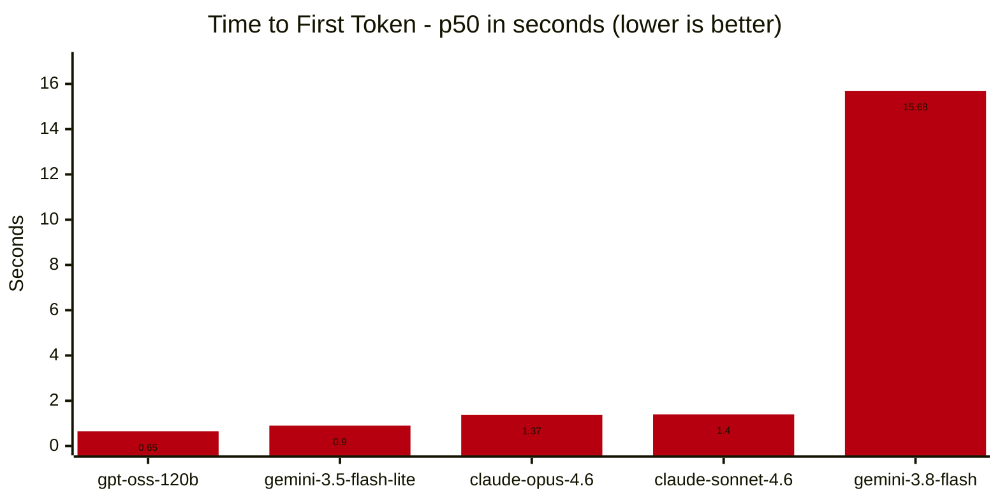
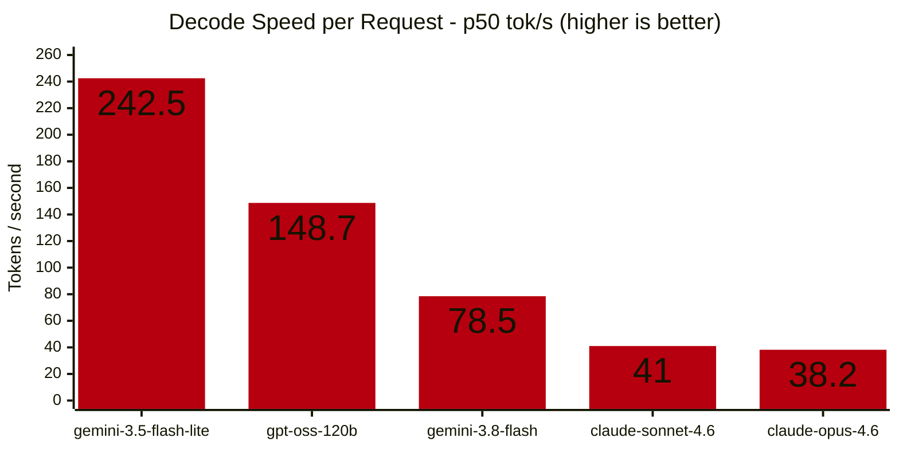

Topik mengenai Akal Imitasi (AI) memang seru. *Agentic coding* dan *AI assistant* menjadi experiment di akhir pekan. Namun hobi baru ini sayangnya membawa dampak negatif untuk kantong saya: boros di token. Sampai akhirnya saya menemukan solusi yang abu-abu, yaitu link invitation murah untuk Gemini Pro dari Jio yang bebas dijual dengan harga di bawah 50 ribu rupiah.

Walaupun tidak *eligible* untuk model yang terbaru, namun model yang ditawarkan sebanding dengan harganya: Claude Opus 4.6 & Sonnet 4.6, Gemini 3.8 Flash & 3.5 Flash Lite, dan yang terakhir ada GPT OSS 120B. List model yang sangat cukup untuk kebutuhan saya. Namun bagaimana dengan performanya?

Sebagai informasi pelengkap, Gemini Pro ini saya pasangkan ke [9router-go](https://github.com/luqman-v1/9router-go) menggunakan Antigravity connector. Langkah ini harus dilakukan agar model yang ada di Antigravity bisa digunakan di *platform* lain seperti Opencode atau Hermes Agent.

### Metodologi

Pengujian dilakukan dalam jaringan lokal. 9router-go ada di Unraid NAS, sementara client ada di VM dengan Alpine Linux sebagai sistem operasinya. Pengujian dilakukan secara otomatis menggunakan [llm-bench.sh](/static/assets/downloads/scripts/llm-bench.sh). Menggunakan script tersebut, setiap model akan diuji hingga 20 kali, sedangkan hasil akan diambil dari rata-rata dari setiap percobaan. Terakhir, hasil pengujian disimpan dalam bentuk berkas `.csv`.

Fokus pengujian ini ada di model Gemini 3.8 Flash, dengan alasan berikut:
1. Gemini 3.8 Flash adalah model *first party* yang tersedia untuk paket langganan ini
2. Gemini 3.8 Flash adalah model tertinggi yang bisa diakses (3.1 Pro adn 4 Argon sayangnya tidak tersedia)
3. Model lain khususnya Claude hanya pemanis, karena limit untuk model tersebut sangat terbatas

### Hasil Pengujian

Hal yang sangat menarik dari pengujian ini adalah Gemini 3.8 Flash — model besutan Google sendiri — justru yang paling lamban dalam hal *time to first token* (TTFT). Gemini 3.8 Flash rata-rata membutuhkan waktu hingga 15 detik lebih untuk memproduksi token pertama yang ter-ekspos melalui API `/chat/completion`. 

Saya menduga bahwa Gemini 3.8 Flash melakukan *hidden thinking* di balik layar. Entah ini karena 9router atau dari Antigravity itu sendiri. Saya perlu membuktikan lebih lanjut dengan cara melakukan pengujian melalui Antigravity secara langsung.

GPT OSS 120B dan Gemini 3.5 Flash Lite adalah 2 model yang tercepat dalam hal waktu untuk memproduksi token pertama. Ini sebenarnya wajar, karena kedua model tersebut memiliki parameter yang paling sedikit sehingga membutuhkan waktu lebih singkat untuk melakukan *prompt encoding*.

Dalam segi kecepatan dalam memproduksi token (*token per second*) Gemini 3.8 Flash tidak lagi menjadi yang terbelakang. Berada dalam urutan ketiga, 78.5 token/s menurut saya lumayan untuk kebutuhan saya. Meskipun untuk orang yang sudah pernah mecoba model *flash* lain yang lebih cepat seperti Deepseek v4.1 Flash, 78 token/s akan terasa lambat.

Sesuai dugaan, GPT OSS 120B menjadi yang tercepat dan Opus 4.6 menjadi yang terlambat, dengan alasan yang sama seperti alasan yang saya sebutkan di atas.

### Penilaian Subjektif

Saya sudah menggunakan paket langganan ini sejak pertengahan September 2026. Sejak saat itu saya gunakan model-model tersebut di platform OpenCode untuk *coding* dan Vellum dan Hermess Agent untuk *personal assistant*.

Meskipun Sonnet 4.6 sudah bisa dibilang usang bila dibandingkan dengan Sonnet 5.5 (terbaru pada saat artikel ini ditulis), namun 4.6 masih sangat *capable* apabila dibandingkan dengan *flash* model seperti Gemini 3.8 Flash ataupun Deepseek v4.1 Flash. Yang sangat saya sukai dari Sonnet 4.6 adalah model ini sangat menjiwai ketika dijadikan model utama di Vellum Assistant. Personality yang saya atur di awal benar-benar dijalankan dengan baik. Beda dengan Gemini yang terkesan kurang punya 'jiwa'. Namun sekali lagi dan sayang sekali, kuota Claude terbatas sekali dan sangat cepat habis.

Selain itu Sonnet 4.6 — meskipun tidak secepat Gemini 3.8 Flash dalam memproduksi token — hampir selalu menyelesaikan *task*. Hal ini terjadi karena Sonnet langkah-langkah yang dia jalankan hampir selalu berhasil. Kontras bila dibandingkan dengan Gemini yang harus mengulang langkah ini dan itu karena salah *syntax* dan sebagainya.

Sementara itu, Gemini 3.8 Flash yang seharusnya menjadi bintang model di paket langganan ini, justru menjadi model yang paling tidak nyaman untuk digunakan. *Delay* 15 detik seringkali menjengkelkan ketika model ini dijadikan model utama untuk *personal assistant*.

### Akhir Kata

Dengan modal 30–50 ribu rupiah yang aktif selama 18 bulan, paket ini sangat layak untuk dicoba. Beberapa kekurangan yang saya temukan masih bisa diterima untuk penggunaan ringan. Namun apabila penggunaan untuk professional, berlangganan melalui provider API resmi akan lebih baik lagi.

Stay curious! ✨
